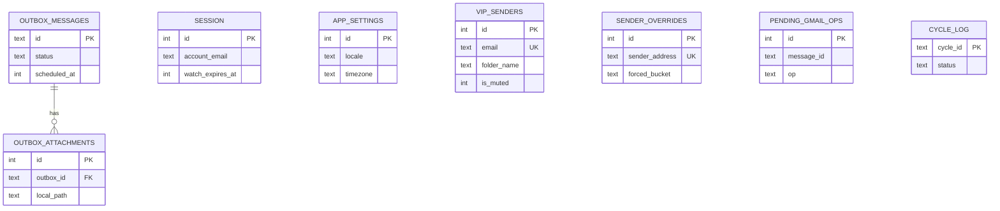
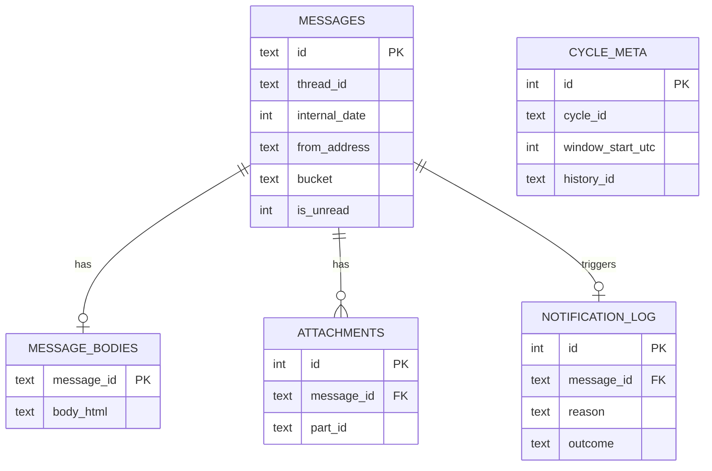

# Gmailoo: Database Schema

**Version:** 0.1 (draft) · **Companion to:** Gmailoo PRD v0.1 · **Local engine:** SQLite + SQLCipher via `drift` · **Backend:** Cloud Firestore (push routing only)

This document defines every table Gmailoo stores, where it lives, and what happens to it when the weekly cycle ends. All SQL in this file is runnable as written in SQLite 3.35+.

---

## 1. Design Decisions

| # | Decision | Why |
|---|---|---|
| 1 | **Two local database files**: `gmailoo_core.sqlite` (persistent) and `gmailoo_cycle.sqlite` (ephemeral) | The PRD says the weekly wipe must be *complete*. Deleting one file is atomic and leaves no free pages or journal remnants, unlike `DELETE` + `VACUUM`. |
| 2 | **No SQL dependency from the cycle DB to the core DB** | Cross-file foreign keys don't exist in SQLite. VIP and override data is passed in from Dart as parameters, so the cycle DB can be deleted at any time without breaking the core DB. |
| 3 | **VIP folders are virtual**: a folder is `WHERE from_address = ?`, not a table of memberships | Membership can't go stale, and the wipe has nothing extra to clean (PRD VIP-3). |
| 4 | **"Important unread" is derived** (`bucket = 'important' AND is_unread = 1`), not stored | Reading a message flips one column; no bucket re-assignment, no drift between two fields (PRD SF-3). |
| 5 | **The cycle DB never migrates**: on a schema version mismatch, delete it and resync | It only holds a copy of at most one week of mail, so a resync is cheaper than writing migrations. |
| 6 | **Firestore stores no email content**, only hashed address, device tokens, and watch expiry | Matches push Option A in the PRD (client-side classification). |

Single-account in v1. Multi-account (v2) will add an `account_id` column to the per-account tables.

---

## 2. Storage Map

| Store | File / collection | Survives weekly wipe? | Contents |
|---|---|---|---|
| **Core DB** | `gmailoo_core.sqlite` | **Yes** | Session, settings, VIP senders, sender overrides, outbox (drafts + scheduled), pending Gmail operations, cycle log |
| **Cycle DB** | `gmailoo_cycle.sqlite` | **No: file deleted each cycle** | Cycle metadata, messages, bodies, attachments, notification log |
| **Attachment cache** | `<cache>/cycle_attachments/` | **No: directory deleted** | Downloaded Gmail attachments |
| **Outbox files** | `<support>/outbox_files/` | Yes (except sent items) | Attachments for drafts and scheduled sends |
| **Secure storage** | Keychain / Keystore | Yes | SQLCipher key, OAuth tokens (never in SQLite) |
| **Firestore** | `users/{uid}`, `users/{uid}/devices/{id}` | n/a (server) | Hashed email, FCM tokens, watch expiry |

---

## 3. Entity-Relationship Diagrams

### Core DB



### Cycle DB



*Logical (non-SQL) links between the two files:* `messages.from_address` matches `vip_senders.email` and `sender_overrides.sender_address`; `pending_gmail_ops.message_id` matches `messages.id`.

---

## 4. Conventions

| Topic | Convention |
|---|---|
| **Timestamps** | `INTEGER`, epoch **milliseconds, UTC**. Convert with `DateTime.fromMillisecondsSinceEpoch(ms, isUtc: true)`. |
| **Booleans** | `INTEGER` 0/1 with a `CHECK (col IN (0,1))`. |
| **Enums** | `TEXT` with a `CHECK ... IN (...)`; values listed in section 7. |
| **Email addresses** | Stored **lowercase**; a `CHECK (col = lower(col))` enforces it. |
| **Lists of people** | JSON arrays of `{"name": ..., "email": ...}` in `TEXT` columns (`*_json`). They are never filtered on, so they aren't normalized. |
| **Cycle ID** | `'YYYY-MM-DD'`: the *local* date of the cycle's Saturday, in the user's timezone. |
| **IDs** | Gmail ids (`messages.id`, `thread_id`) are Gmail's own strings. Local rows use `INTEGER AUTOINCREMENT`; outbox rows use a UUID v4. |
| **Pragmas** | `foreign_keys = ON`, `journal_mode = WAL` on both DBs. |

---

## 5. Core Database (persistent)

```sql
-- FILE: core
PRAGMA foreign_keys = ON;

-- Singleton: who is signed in. Tokens are NOT stored here (see section 11).
CREATE TABLE session (
  id               INTEGER PRIMARY KEY CHECK (id = 1),
  account_email    TEXT    NOT NULL CHECK (account_email = lower(account_email)),
  firebase_uid     TEXT    NOT NULL,
  watch_expires_at INTEGER,                  -- from the Gmail users.watch response
  created_at       INTEGER NOT NULL
);

-- Singleton: user preferences.
CREATE TABLE app_settings (
  id                     INTEGER PRIMARY KEY CHECK (id = 1),
  locale                 TEXT    NOT NULL DEFAULT 'system' CHECK (locale IN ('system','ar-EG','en-US')),
  digit_style            TEXT    NOT NULL DEFAULT 'locale' CHECK (digit_style IN ('locale','western','arabic_indic')),
  theme_mode             TEXT    NOT NULL DEFAULT 'system' CHECK (theme_mode IN ('system','light','dark')),
  timezone               TEXT    NOT NULL DEFAULT 'Africa/Cairo',
  notifications_enabled  INTEGER NOT NULL DEFAULT 1 CHECK (notifications_enabled IN (0,1)),
  quiet_hours_enabled    INTEGER NOT NULL DEFAULT 0 CHECK (quiet_hours_enabled IN (0,1)),
  quiet_start_minute     INTEGER NOT NULL DEFAULT 1380 CHECK (quiet_start_minute BETWEEN 0 AND 1439),  -- 23:00
  quiet_end_minute       INTEGER NOT NULL DEFAULT 420  CHECK (quiet_end_minute   BETWEEN 0 AND 1439),  -- 07:00
  notify_group_window_min INTEGER NOT NULL DEFAULT 10  CHECK (notify_group_window_min >= 1),
  onboarding_completed   INTEGER NOT NULL DEFAULT 0 CHECK (onboarding_completed IN (0,1)),
  updated_at             INTEGER NOT NULL
);

-- VIP senders. The "folder" is virtual: messages WHERE from_address = email.
CREATE TABLE vip_senders (
  id           INTEGER PRIMARY KEY AUTOINCREMENT,
  email        TEXT    NOT NULL UNIQUE CHECK (email = lower(email)),
  display_name TEXT,
  folder_name  TEXT    NOT NULL,
  is_muted     INTEGER NOT NULL DEFAULT 0 CHECK (is_muted IN (0,1)),
  sort_order   INTEGER NOT NULL DEFAULT 0,
  created_at   INTEGER NOT NULL
);

-- Per-sender manual category corrections (PRD SF-2). Outrank automatic rules.
CREATE TABLE sender_overrides (
  id             INTEGER PRIMARY KEY AUTOINCREMENT,
  sender_address TEXT    NOT NULL UNIQUE CHECK (sender_address = lower(sender_address)),
  forced_bucket  TEXT    NOT NULL CHECK (forced_bucket IN ('important','timetables','marketing','other')),
  created_at     INTEGER NOT NULL
);

-- Drafts, scheduled sends, and send history for the current cycle.
CREATE TABLE outbox_messages (
  id                 TEXT    PRIMARY KEY,                      -- UUID v4
  status             TEXT    NOT NULL CHECK (status IN ('draft','scheduled','sending','sent','failed')),
  to_json            TEXT    NOT NULL DEFAULT '[]',
  cc_json            TEXT    NOT NULL DEFAULT '[]',
  bcc_json           TEXT    NOT NULL DEFAULT '[]',
  subject            TEXT    NOT NULL DEFAULT '',
  body_text          TEXT    NOT NULL DEFAULT '',
  body_html          TEXT,
  reply_to_thread_id TEXT,                                     -- replies keep working after the original is wiped
  in_reply_to_header TEXT,                                     -- RFC 5322 Message-ID of the original
  references_header  TEXT,
  scheduled_at       INTEGER,                                  -- epoch ms UTC
  attempt_count      INTEGER NOT NULL DEFAULT 0 CHECK (attempt_count >= 0),
  last_error         TEXT,
  gmail_message_id   TEXT,                                     -- set once sent
  created_at         INTEGER NOT NULL,
  updated_at         INTEGER NOT NULL,
  sent_at            INTEGER,
  CHECK (status <> 'scheduled' OR scheduled_at IS NOT NULL),
  CHECK (status <> 'sent' OR (sent_at IS NOT NULL AND gmail_message_id IS NOT NULL))
);
-- Partial index: only scheduled rows. The outbox is tiny, so no other index is needed.
CREATE INDEX idx_outbox_due ON outbox_messages (scheduled_at) WHERE status = 'scheduled';

CREATE TABLE outbox_attachments (
  id         INTEGER PRIMARY KEY AUTOINCREMENT,
  outbox_id  TEXT    NOT NULL REFERENCES outbox_messages (id) ON DELETE CASCADE,
  filename   TEXT    NOT NULL,
  mime_type  TEXT    NOT NULL,
  size_bytes INTEGER NOT NULL CHECK (size_bytes >= 0),
  local_path TEXT    NOT NULL                                  -- copy inside app-private storage
);
CREATE INDEX idx_outbox_att_outbox ON outbox_attachments (outbox_id);

-- Offline-safe queue for changes that must reach Gmail (read state).
-- Lives in core so a pending change survives the weekly wipe.
CREATE TABLE pending_gmail_ops (
  id            INTEGER PRIMARY KEY AUTOINCREMENT,
  message_id    TEXT    NOT NULL,
  op            TEXT    NOT NULL CHECK (op IN ('mark_read','mark_unread')),
  attempt_count INTEGER NOT NULL DEFAULT 0 CHECK (attempt_count >= 0),
  created_at    INTEGER NOT NULL,
  UNIQUE (message_id, op)
);

-- Reliability record for the wipe (metric: 100% success). Contains no email content.
CREATE TABLE cycle_log (
  cycle_id         TEXT    PRIMARY KEY,                        -- 'YYYY-MM-DD'
  started_at       INTEGER NOT NULL,
  wiped_at         INTEGER,
  message_count    INTEGER,                                    -- count at wipe time only
  wipe_duration_ms INTEGER,
  status           TEXT    NOT NULL CHECK (status IN ('active','wiped','wipe_failed'))
);
```

---

## 6. Cycle Database (ephemeral)

```sql
-- FILE: cycle
PRAGMA foreign_keys = ON;

-- Singleton describing this cycle's window and sync cursor.
CREATE TABLE cycle_meta (
  id                       INTEGER PRIMARY KEY CHECK (id = 1),
  schema_version           INTEGER NOT NULL,
  cycle_id                 TEXT    NOT NULL,                   -- 'YYYY-MM-DD' (the Saturday)
  timezone                 TEXT    NOT NULL,                   -- tz used to compute the window
  window_start_utc         INTEGER NOT NULL,                   -- Saturday 00:00:00 local, in UTC ms
  window_end_utc           INTEGER NOT NULL,                   -- Thursday 23:59:59.999 local, in UTC ms
  history_id               TEXT,                               -- Gmail history cursor (NULL = needs full sync)
  last_full_sync_at        INTEGER,
  last_incremental_sync_at INTEGER,
  created_at               INTEGER NOT NULL,
  CHECK (window_end_utc > window_start_utc)
);

CREATE TABLE messages (
  id                   TEXT    PRIMARY KEY,                    -- Gmail message id
  thread_id            TEXT    NOT NULL,
  internal_date        INTEGER NOT NULL,                       -- Gmail internalDate, epoch ms UTC
  from_address         TEXT    NOT NULL CHECK (from_address = lower(from_address)),
  from_name            TEXT,
  to_json              TEXT    NOT NULL DEFAULT '[]',
  cc_json              TEXT    NOT NULL DEFAULT '[]',
  subject              TEXT    NOT NULL DEFAULT '',
  snippet              TEXT    NOT NULL DEFAULT '',
  label_ids_json       TEXT    NOT NULL DEFAULT '[]',
  message_id_header    TEXT,                                   -- RFC 5322 Message-ID (needed to reply)
  references_header    TEXT,
  is_unread            INTEGER NOT NULL CHECK (is_unread IN (0,1)),
  is_gmail_important   INTEGER NOT NULL CHECK (is_gmail_important IN (0,1)),
  has_attachments      INTEGER NOT NULL DEFAULT 0 CHECK (has_attachments IN (0,1)),
  has_calendar_invite  INTEGER NOT NULL DEFAULT 0 CHECK (has_calendar_invite IN (0,1)),
  has_list_unsubscribe INTEGER NOT NULL DEFAULT 0 CHECK (has_list_unsubscribe IN (0,1)),
  bucket               TEXT    NOT NULL CHECK (bucket IN ('important','timetables','marketing','other')),
  bucket_source        TEXT    NOT NULL DEFAULT 'rule' CHECK (bucket_source IN ('rule','override')),
  matched_rule         TEXT,                                   -- which rule fired (explainability)
  body_fetched         INTEGER NOT NULL DEFAULT 0 CHECK (body_fetched IN (0,1)),
  synced_at            INTEGER NOT NULL
);
CREATE INDEX idx_messages_bucket_date ON messages (bucket, is_unread, internal_date);
CREATE INDEX idx_messages_from        ON messages (from_address, internal_date);
CREATE INDEX idx_messages_thread      ON messages (thread_id, internal_date);

-- Bodies are split out so list queries never scan large HTML.
CREATE TABLE message_bodies (
  message_id TEXT    PRIMARY KEY REFERENCES messages (id) ON DELETE CASCADE,
  body_html  TEXT,
  body_text  TEXT,
  fetched_at INTEGER NOT NULL
);

CREATE TABLE attachments (
  id                  INTEGER PRIMARY KEY AUTOINCREMENT,
  message_id          TEXT    NOT NULL REFERENCES messages (id) ON DELETE CASCADE,
  part_id             TEXT    NOT NULL,                        -- MIME part id (stable; Gmail attachmentId is not)
  gmail_attachment_id TEXT,
  filename            TEXT    NOT NULL,
  mime_type           TEXT    NOT NULL,
  size_bytes          INTEGER NOT NULL CHECK (size_bytes >= 0),
  local_path          TEXT,                                    -- NULL until downloaded
  downloaded_at       INTEGER,
  UNIQUE (message_id, part_id)
);

-- One row per message that was considered for a push. Drives de-duplication,
-- grouping, and the "why was I pinged" subtitle (PRD ZN-3).
CREATE TABLE notification_log (
  id         INTEGER PRIMARY KEY AUTOINCREMENT,
  message_id TEXT    NOT NULL UNIQUE REFERENCES messages (id) ON DELETE CASCADE,
  reason     TEXT    NOT NULL CHECK (reason IN ('vip','important_unread')),
  outcome    TEXT    NOT NULL CHECK (outcome IN
               ('delivered','grouped','suppressed_quiet_hours','suppressed_muted_vip','suppressed_disabled')),
  created_at INTEGER NOT NULL
);
```

**Window rule (enforced in the repository, since SQL can't CHECK across tables):** a message is inserted only if `internal_date BETWEEN cycle_meta.window_start_utc AND cycle_meta.window_end_utc`.

---

## 7. Enum Reference

| Column | Values | Meaning |
|---|---|---|
| `messages.bucket` | `important`, `timetables`, `marketing`, `other` | Stored bucket. "Important unread" = `important` + `is_unread = 1`. `other` is the fallback bucket recommended in the PRD risks. |
| `messages.bucket_source` | `rule`, `override` | Whether the bucket came from the rule chain or a user override. |
| `outbox_messages.status` | `draft`, `scheduled`, `sending`, `sent`, `failed` | Lifecycle: draft → scheduled → sending → sent / failed (failed can retry). |
| `pending_gmail_ops.op` | `mark_read`, `mark_unread` | Queued Gmail label changes. |
| `notification_log.reason` | `vip`, `important_unread` | `vip` wins if both apply. |
| `notification_log.outcome` | `delivered`, `grouped`, `suppressed_quiet_hours`, `suppressed_muted_vip`, `suppressed_disabled` | What the notification policy decided. |
| `cycle_log.status` | `active`, `wiped`, `wipe_failed` | Wipe lifecycle. |

---

## 8. Access Patterns and Queries

| # | Use case | Query (parameters as `:name`) | Index used |
|---|---|---|---|
| Q1 | **Important unread** list | `SELECT * FROM messages WHERE bucket='important' AND is_unread=1 ORDER BY internal_date DESC LIMIT :n OFFSET :o` | `idx_messages_bucket_date` |
| Q2 | **Important** (read) list | same, with `is_unread=0` | `idx_messages_bucket_date` |
| Q3 | **Timetables / Marketing / Other** | `... WHERE bucket=:b ORDER BY internal_date DESC` | `idx_messages_bucket_date` |
| Q4 | **VIP folder** | `SELECT * FROM messages WHERE from_address=:email ORDER BY internal_date DESC` | `idx_messages_from` |
| Q5 | **Tab badges** | `SELECT bucket, is_unread, COUNT(*) FROM messages GROUP BY bucket, is_unread` | `idx_messages_bucket_date` |
| Q6 | **Thread view** | `SELECT * FROM messages WHERE thread_id=:t ORDER BY internal_date` | `idx_messages_thread` |
| Q7 | **Mark as read** | `UPDATE messages SET is_unread=0 WHERE id=:id` (and enqueue `mark_read` in core first) | PK |
| Q8 | **Apply override** | `UPDATE messages SET bucket=:b, bucket_source='override', matched_rule='sender_override' WHERE from_address=:addr` | `idx_messages_from` |
| Q9 | **Notification-eligible new mail** | see below | PK + `idx_messages_from` |
| Q10 | **Gmail deleted/trashed a message** | `DELETE FROM messages WHERE id IN (...)` (cascades to bodies, attachments, log) | PK |
| Q11 | **Due scheduled sends** (core) | `SELECT * FROM outbox_messages WHERE status='scheduled' AND scheduled_at <= :now ORDER BY scheduled_at` | `idx_outbox_due` |
| Q12 | **Stale-cycle check on launch** | `SELECT cycle_id FROM cycle_meta WHERE id=1` | PK |

**Q9: notification eligibility.** VIP and muted lists come from the core DB and are passed in as parameters:

```sql
SELECT m.id,
       CASE WHEN m.from_address IN (:vip_emails) THEN 'vip' ELSE 'important_unread' END AS reason
FROM messages m
LEFT JOIN notification_log n ON n.message_id = m.id
WHERE n.id IS NULL
  AND m.id IN (:new_ids)
  AND m.from_address NOT IN (:muted_vip_emails)
  AND (m.from_address IN (:vip_emails) OR (m.bucket = 'important' AND m.is_unread = 1));
```

**Q7 ordering:** the two writes are in different database files, so they can't share a transaction. Write the `pending_gmail_ops` row **first**, then update `messages`. A crash between them leaves a harmless extra op, never a lost one; ops are idempotent.

---

## 9. Weekly Wipe Procedure

The wipe is "close, delete, recreate", never "delete rows."

```text
wipeIfCycleChanged():
  1. currentId = CycleClock.cycleIdFor(now, timezone)
  2. if cycle DB exists and cycle_meta.cycle_id == currentId and schema_version matches -> return
  3. acquire wipe mutex; pause sync and notification handling
  4. core: cycle_log SET status='wipe_failed' WHERE status='active'   -- provisional
  5. close all cycle DB connections
  6. delete gmailoo_cycle.sqlite, -wal, -shm, -journal
  7. delete <cache>/cycle_attachments/ recursively
  8. core: DELETE FROM outbox_messages WHERE status='sent'            -- cascades; delete their files
  9. create new cycle DB; INSERT cycle_meta (new window, history_id NULL)
 10. core: cycle_log SET previous row status='wiped', wiped_at, message_count, wipe_duration_ms;
           INSERT new row status='active'
 11. release mutex; trigger full sync
```

**Why it's crash-safe:** step 4 marks the previous cycle as failed *before* anything is deleted, and step 10 flips it to `wiped` only at the end. If the app dies anywhere in between, the next launch sees a stale `cycle_id` (or a missing file), re-enters step 3, and every step is idempotent. Run this check on every launch and resume; a background task is a best-effort bonus, never the only trigger.

**Retained across the wipe:** `session`, `app_settings`, `vip_senders`, `sender_overrides`, drafts and scheduled/failed outbox rows, `pending_gmail_ops`, `cycle_log`. **Trim `cycle_log`** to the last 12 rows.

---

## 10. Backend: Cloud Firestore (push routing only)

This implements push **Option A** from the PRD: the server never reads mail. It only wakes the right devices.

```text
users/{uid}
  emailHash          string   SHA-256 of the lowercased Gmail address (indexed)
  locale             string   'ar-EG' | 'en-US'
  watchExpiresAt     timestamp   when the client's Gmail watch lapses
  renewNudgeSentAt   timestamp?  last "renew your watch" silent push
  notificationsEnabled bool
  createdAt, lastSeenAt  timestamp

users/{uid}/devices/{deviceId}
  fcmToken           string
  platform           string   'android' | 'ios'
  appVersion         string
  updatedAt          timestamp
  expireAt           timestamp   Firestore TTL field (updatedAt + 60 days)
```

**Flow**

1. Gmail → Pub/Sub delivers `{emailAddress, historyId}` to a Cloud Function.
2. The function hashes `emailAddress`, finds `users` by `emailHash`, and sends each device a **data-only** FCM message `{type: "sync", historyId}`.
3. The app wakes, runs `history.list`, classifies **locally**, and posts a local notification only for VIP / Important unread mail.
4. On FCM `UNREGISTERED` errors the function deletes that device document.

**Writes go through a callable function, not directly from the client.** `registerDevice({fcmToken, platform, appVersion, locale, watchExpiresAt})` sets `emailHash` from the *verified* Firebase Auth token email. This stops one user from registering someone else's hash and receiving their sync pings.

```text
rules_version = '2';
service cloud.firestore {
  match /databases/{db}/documents {
    match /users/{uid} {
      allow read: if request.auth != null && request.auth.uid == uid;
      allow write: if false;                       // callable function (Admin SDK) only
      match /devices/{deviceId} {
        allow read: if request.auth != null && request.auth.uid == uid;
        allow write: if false;
      }
    }
  }
}
```

> **Correction to PRD §6.3:** the PRD suggests a daily Cloud Scheduler job to renew the Gmail `watch`. Under Option A the server holds no OAuth tokens, so **it cannot renew the watch**; renewal must happen on the client (on app open, plus a best-effort background task). That is why `watchExpiresAt` is stored: a scheduled function finds users whose watch expires within ~24 hours and sends them a silent `{type: "renew_watch"}` push. A user who never opens the app and has background wake-ups blocked (common on iOS) will silently stop receiving Zen pushes after about a week. Option B (server-held token) would remove this limitation.

---

## 11. Security and Privacy

| Concern | Requirement |
|---|---|
| **Encryption at rest** | Both DBs opened with SQLCipher. The key is generated on first launch and kept in Keychain/Keystore (`flutter_secure_storage`; iOS accessibility `first_unlock_this_device_only`, so it can't restore to another device). |
| **Tokens** | OAuth access/refresh tokens live only in secure storage, never in SQLite. |
| **Backups** | **Exclude DB files and attachments from OS backups.** Android: `android:allowBackup="false"` or data-extraction rules excluding the files. iOS: set `isExcludedFromBackup` on the DB directory. Otherwise Auto Backup / iCloud can copy last week's mail off the device and defeat the wipe. |
| **File locations** | DBs in the application *support* directory (not user-visible documents). Attachment cache in the cache directory. |
| **Logging** | Never log `subject`, `snippet`, bodies, or addresses. `cycle_log` stores counts only. |
| **Sign-out** | Delete both DB files, outbox files, secure-storage keys, and the device document (via a callable function). |
| **Firestore** | Hashed email only; no subjects, senders, or message ids. TTL on stale devices. |
| **Contacts privacy** | VIP lists are email addresses of the user's contacts. They stay local in v1 (see open issue 3). |

---

## 12. Migrations and Versioning

- **Core DB:** `drift` `schemaVersion` with `MigrationStrategy.onUpgrade` using step-by-step migrations. Dump schemas with `drift_dev schema dump` and keep generated migration tests in CI.
- **Cycle DB:** no migrations. Store `schema_version` in `cycle_meta`; if it differs from the app's constant, treat it like a cycle change: delete the file and resync.
- **Destructive changes** to the core DB (rename a column, change an enum) need a data-preserving migration because it holds the user's VIP list and drafts.

---

## 13. Implementation Notes (drift)

Two database classes, one per file. Share table definitions only where truly shared (none today).

```dart
// lib/core/database/cycle/tables.dart
enum MailBucket { important, timetables, marketing, other }
enum BucketSource { rule, override }

@TableIndex(name: 'idx_messages_bucket_date', columns: {#bucket, #isUnread, #internalDate})
@TableIndex(name: 'idx_messages_from', columns: {#fromAddress, #internalDate})
@TableIndex(name: 'idx_messages_thread', columns: {#threadId, #internalDate})
class Messages extends Table {
  TextColumn get id => text()();
  TextColumn get threadId => text()();
  IntColumn get internalDate => integer()();           // epoch ms UTC
  TextColumn get fromAddress => text()();              // lowercased before insert
  TextColumn get fromName => text().nullable()();
  TextColumn get subject => text().withDefault(const Constant(''))();
  TextColumn get snippet => text().withDefault(const Constant(''))();
  BoolColumn get isUnread => boolean()();
  TextColumn get bucket => textEnum<MailBucket>()();
  TextColumn get bucketSource =>
      textEnum<BucketSource>().withDefault(Constant(BucketSource.rule.name))();
  // ... remaining columns map 1:1 to the SQL in section 6.

  @override
  Set<Column> get primaryKey => {id};
}

@DriftDatabase(tables: [CycleMeta, Messages, MessageBodies, Attachments, NotificationLog])
class CycleDatabase extends _$CycleDatabase {
  CycleDatabase(super.e);
  @override
  int get schemaVersion => 1; // bump => file is deleted and resynced, no migration code
}
```

- Mirror the `CHECK` constraints from the SQL via `customConstraints`, or keep the SQL as the source of truth and verify them in a test.
- Open both databases with an encrypted `NativeDatabase` (SQLCipher) and run `PRAGMA foreign_keys = ON; PRAGMA journal_mode = WAL;` in the `setup` callback.
- Expose repositories from the data layer only (`MailLocalDataSource`, `VipLocalDataSource`, `OutboxLocalDataSource`). Domain code never imports `drift`.

---

## 14. Invariants to Test

1. After a wipe, `gmailoo_cycle.sqlite*` and the attachment cache directory do not exist; `vip_senders`, `outbox_messages` (non-sent), and `app_settings` are unchanged.
2. A message outside `[window_start_utc, window_end_utc]` is never inserted.
3. Marking a message read moves it from Q1 to Q2 with no other write.
4. A muted VIP never produces a push, even if Gmail marks the mail important.
5. A message produces at most one `notification_log` row (re-delivery is idempotent).
6. Killing the app at each numbered wipe step, then relaunching, always converges to a clean new cycle.
7. A `scheduled` outbox row with `scheduled_at` in the past is picked up exactly once.
8. Timezone/DST edge: the window boundaries recomputed on the DST changeover day still land on local Saturday 00:00 and Thursday 23:59:59.

---

## 15. Open Issues

1. **Volume cap:** a heavy week could exceed a few thousand messages. Decide a per-cycle cap and what the user sees when it's hit (suggest: newest first, with a "showing latest N" banner).
2. **Full-text search:** out of scope for v1. If added, use an SQLite FTS5 virtual table in the cycle DB so it wipes with the file.
3. **New-device continuity:** VIP list and settings are local-only, so a new phone starts empty. An opt-in encrypted sync would fix this but moves contact addresses off-device; decide before v1.
4. **Friday mail** (PRD open question 1) affects `window_start_utc` for the next cycle.
5. **Attachment size and retention:** decide a download cap (e.g., 25 MB per file) and whether attachments are fetched on demand only.
